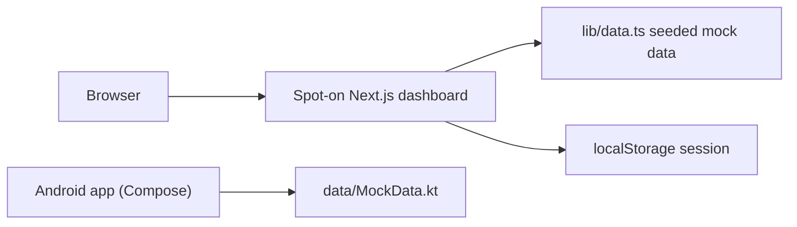

# Spot-on

A look-alike recreation of a restaurant point-of-sale merchant dashboard (SpotOn style) as a Next.js web app plus an Android app, running entirely on fake data.

## What it is

A clickable demo of a restaurant back-office: a sign-in flow and sixteen more sections for sales, reporting, orders, menus, labor, reservations, customers, loyalty, campaigns, reviews, online ordering, gift cards, statements, devices, dashboard users and settings. Every number is generated inside the app. It does not connect to SpotOn or to any backend or other CultureReset service. It is an independent recreation, not affiliated with SpotOn.

## How it works

- `app/login/page.tsx` - multi-step sign-in screen; `app/(dash)/layout.tsx` guards the dashboard routes and provides the shell.
- `app/(dash)/<section>/page.tsx` - one page per section (`campaigns`, `customers`, `devices`, `employees`, `gift-cards`, `loyalty`, `menus`, `online-ordering`, `orders`, `reporting`, `reservations`, `reviews`, `sales`, `settings`, `statements`, `users`), plus `app/(dash)/page.tsx` for the dashboard home.
- `lib/data.ts` - seeded pseudo-random mock data with a fixed reference date, so it renders the same every time.
- `lib/session.tsx` - session, location and date range kept in the browser's `localStorage`.
- `components/charts/index.tsx` - hand-built SVG charts; `components/ui`, `components/shell` - shared UI and layout.
- `android/` - Kotlin + Jetpack Compose app under `android/app/src/main/java/com/spoton/merchant/` (`data/MockData.kt`, `nav/`, `ui/screens`), with its own Gradle build.
- No `fetch` calls, no environment variables and no external URLs are used in `app/`, `lib/` or `components/`.

## Run it

Web (Node with npm):

```bash
npm install
npm run dev            # http://localhost:3000
npm run build && npm start
```

No environment variables are needed. On the login screen use the demo-account option; the session is stored in `localStorage`.

Android: open `android/` in Android Studio (Gradle project). See `android/README.md`.

## Status

**Stalled.** A finished-looking, self-contained demo clone of a third-party product (single commit, 2026-08-30) that is not wired to any CultureReset data. The repo's `main` branch is only a stub; the work lives on the default branch `claude/spot-on-dashboard-recreation-wki85d`.

## Where it fits



It calls no outside service and nothing calls it.

## Related repos

- `Toast`, `Yelp`, `U-b-e-r` and similar - other look-alike recreations of third-party products built the same way (mock data, no backend); different code.
- Not connected to `gcr-api-clean` or the GCR/CyberCheck apps.
